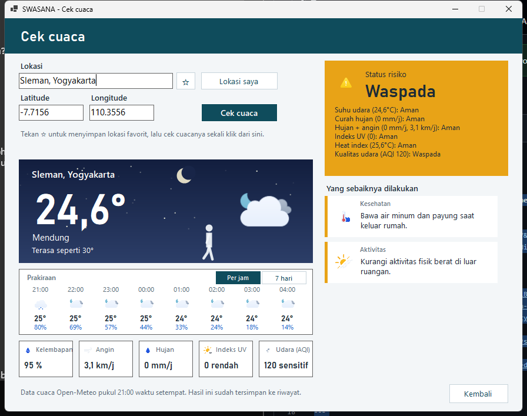
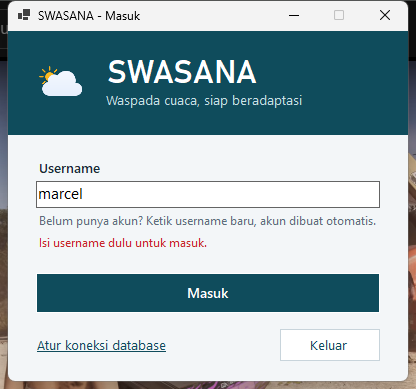
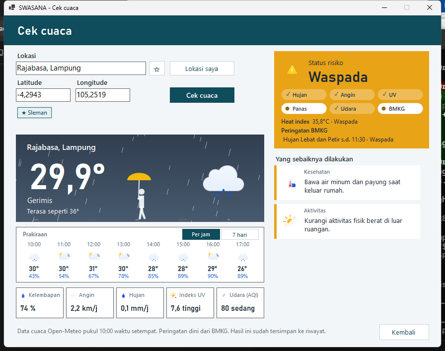
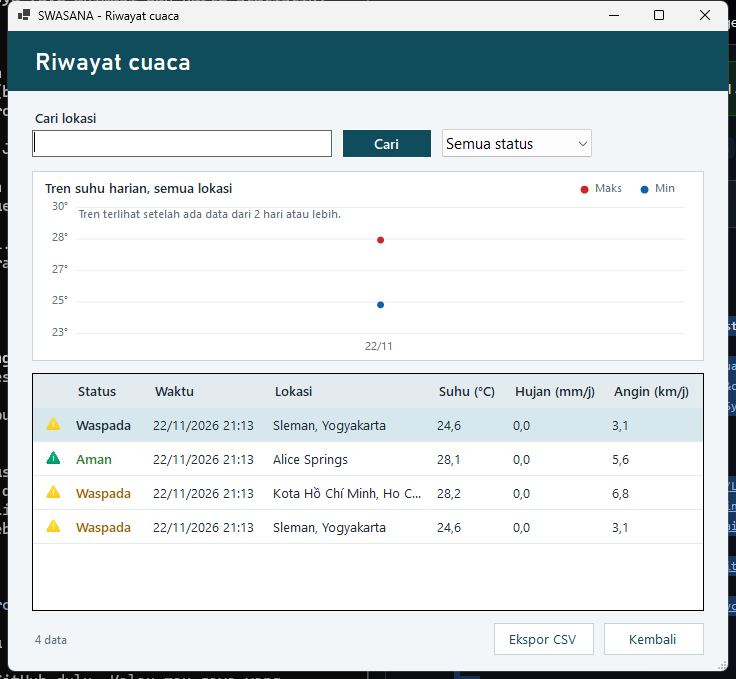
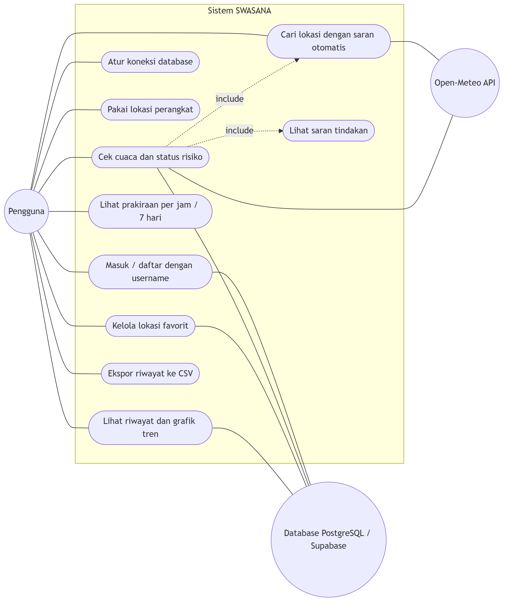
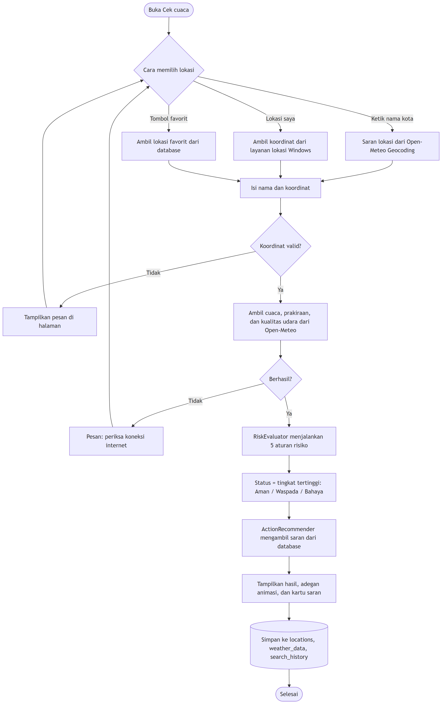
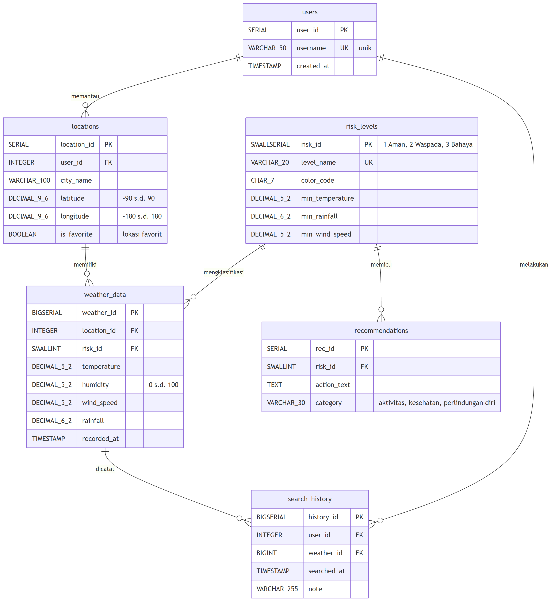

# SWASANA

**Sistem Waspada Suasana & Adaptasi Iklim**: aplikasi desktop Windows untuk mengecek cuaca terkini, menilai tingkat risikonya (**Aman / Waspada / Bahaya**), dan memberi saran tindakan yang bisa langsung dilakukan.

Junior Project (Teknik Basis Data, Pemrograman Berbasis Objek), Departemen Teknik Elektro dan Teknologi Informasi, Fakultas Teknik, Universitas Gadjah Mada.

**[Unduh versi terbaru](https://github.com/dnday/Junpro6/releases/latest)**: ekstrak `SWASANA.zip`, jalankan `Swasana.exe`, isi koneksi database (PostgreSQL sendiri atau URI Supabase), lalu masuk dengan username. Tidak perlu menginstal .NET.

<video src="demo/SWASANA-demo.mp4" controls width="100%" preload="metadata"></video>

Video demo (±2 menit): masuk, saran lokasi, status risiko, peringatan dini BMKG, favorit, prakiraan 7 hari, dan riwayat. [Unduh video](demo/SWASANA-demo.mp4).

## Daftar isi
- [Latar belakang](#latar-belakang)
- [Fitur](#fitur)
- [Tampilan](#tampilan)
- [Cara pakai](#cara-pakai)
- [Aturan risiko](#aturan-risiko)
- [Rancangan sistem](#rancangan-sistem)
- [Basis data](#basis-data)
- [Class diagram](#class-diagram)
- [Pengujian](#pengujian)
- [Teknologi](#teknologi)
- [Tim](#tim)
- [Kredit](#kredit)
- [Lisensi](#lisensi)

## Latar belakang

Aplikasi cuaca pada umumnya hanya menampilkan angka mentah (suhu, kelembapan, curah hujan) tanpa menjelaskan seberapa berbahaya kondisinya. SWASANA mengubah data cuaca dari Open-Meteo menjadi status risiko yang mudah dipahami, lengkap dengan alasan dan saran tindakan, serta menyimpan riwayat pengecekan untuk melihat tren.

## Fitur

| Fitur | Keterangan |
|---|---|
| Cek cuaca terkini | Suhu, suhu yang terasa, kelembapan, angin, curah hujan, indeks UV, dan kualitas udara (AQI) |
| Pencarian lokasi | Saran lokasi muncul saat mengetik (misalnya "yog" menjadi DI Yogyakarta), lokasi Indonesia didahulukan |
| Lokasi saya | Memakai layanan lokasi Windows, lalu nama tempatnya dicari otomatis |
| Lokasi favorit | Simpan lokasi dengan tombol ☆, cek cuacanya sekali klik |
| Prakiraan | Per jam (8 jam) dan 7 hari ke depan |
| Status risiko | Aman / Waspada / Bahaya dari 6 aturan berbasis BMKG, WHO, NOAA, dan US EPA, termasuk peringatan dini resmi BMKG, ditampilkan beserta nilai yang dinilai |
| Saran tindakan | Kartu saran per kategori (aktivitas, kesehatan, perlindungan diri) |
| Riwayat | Semua pengecekan tersimpan, bisa dicari per lokasi dan disaring per status, dengan grafik tren suhu harian dan ekspor ke CSV |
| Database | PostgreSQL lokal atau database online (Supabase, cukup tempel URI); database dan tabel dibuat otomatis |
| Tampilan | Ikon cuaca, latar langit sesuai cuaca, adegan animasi (hujan, panas, badai, angin, malam), kartu risiko berputar 3D |
| Aksesibilitas | Kontras teks memenuhi WCAG AA, status tidak hanya ditandai warna, animasi mati jika efek animasi Windows dimatikan |

## Tampilan

| Masuk | Menu |
|---|---|
|  |  |

**Saran lokasi saat mengetik**

**Lokasi favorit dan prakiraan 7 hari**

**Status berbeda menyesuaikan kondisi**

**Peringatan dini resmi BMKG ikut dinilai (lokasi di Indonesia)**

**Riwayat dan grafik tren suhu harian**

## Cara pakai

1. Unduh `SWASANA.zip` dari halaman [rilis](https://github.com/dnday/Junpro6/releases/latest) dan ekstrak ke folder mana saja.
2. Jalankan `Swasana.exe`. Jika muncul peringatan SmartScreen, pilih **More info → Run anyway**.
3. Pada pemakaian pertama, isi form **Koneksi database**: PostgreSQL di komputer sendiri, atau tempel URI database online (Supabase).
4. Ketik username lalu **Masuk**. Username baru dikonfirmasi dulu sebelum didaftarkan.
5. Pilih **Cek cuaca**, ketik nama kota lalu pilih dari daftar saran, atau tekan **Lokasi saya**.
6. Tekan **☆** untuk menyimpan lokasi favorit, dan buka **Riwayat** untuk melihat tren.

Kebutuhan: Windows 10 (versi 2004+) / 11 64-bit dan koneksi internet. Panduan lengkap, termasuk menyiapkan database, ada di [PANDUAN.md](https://github.com/dnday/Junpro6/blob/main/PANDUAN.md).

## Aturan risiko

Status akhir adalah tingkat tertinggi dari enam aturan. Setiap aturan adalah class turunan dari `RiskRule` (inheritance) yang mengisi method `Evaluate()` dengan caranya sendiri (polymorphism). Ambang tiap aturan diambil dari peraturan BMKG, pedoman resmi, dan jurnal.

| Aturan | Waspada | Bahaya | Rujukan |
|---|---|---|---|
| Curah hujan | hujan lebat, 10 sampai di bawah 20 mm/jam | hujan sangat lebat, mulai 20 mm/jam | [1], [2] |
| Hujan dan angin | – | hujan mulai 10 mm/jam dan angin di atas 45 km/jam (25 knot) | [1] |
| Indeks UV | sangat tinggi, 8–10 | ekstrem, mulai 11 | [3], [4] |
| Heat index (dari suhu dan kelembapan) | *extreme caution*, 32–41 °C | *danger*, mulai 41 °C | [5], [6] |
| Kualitas udara (US AQI) | tidak sehat bagi kelompok sensitif, 101–150 | tidak sehat, mulai 151 | [7], [8] |
| Peringatan dini BMKG (khusus Indonesia) | ada peringatan aktif di lokasi | peringatan berkeparahan *Severe* atau *Extreme* | [9], [10] |

Aturan suhu udara saja (di atas 33/35 °C) dihapus karena ambang itu tidak ada di peraturan BMKG maupun jurnal; BMKG mendefinisikan suhu ekstrem sebagai penyimpangan dari normal setempat. Penilaian panas memakai heat index, yang menggabungkan suhu dan kelembapan. Peringatan dini BMKG diambil dari feed resmi BMKG (format CAP): aplikasi mengecek apakah koordinat lokasi berada di dalam polygon wilayah peringatan yang masih berlaku.

### Rujukan

1. Badan Meteorologi, Klimatologi, dan Geofisika. (2010). *Peraturan Kepala BMKG Nomor Kep.009 Tahun 2010 tentang Prosedur Standar Operasional Pelaksanaan Peringatan Dini, Pelaporan, dan Diseminasi Informasi Cuaca Ekstrem* (Berita Negara RI 2010 No. 497). Kriteria cuaca ekstrem: hujan lebat mulai 20 mm/jam, angin kencang di atas 25 knot (45 km/jam). Kini digantikan Peraturan BMKG Nomor 9 Tahun 2022.
2. Lestari, T. A., dkk. Analisis hujan sangat lebat yang menyebabkan genangan di sebagian wilayah Jakarta menggunakan citra radar (studi kasus 18 Januari 2022). *Universitas Negeri Jakarta*. https://journal.unj.ac.id/unj/index.php/castle/article/view/67087 (kategori intensitas hujan BMKG; lebih dari 20 mm/jam tergolong sangat lebat).
3. World Health Organization. (2002). *Global Solar UV Index: A Practical Guide*. WHO, WMO, UNEP, ICNIRP.
4. Fioletov, V., Kerr, J. B., & Fergusson, A. (2010). The UV Index: definition, distribution and factors affecting it. *Canadian Journal of Public Health, 101*(4), I5–I9. https://doi.org/10.1007/BF03405303
5. Rothfusz, L. P. (1990). *The Heat Index "Equation"* (NWS Technical Attachment SR 90-23). National Weather Service.
6. Anderson, G. B., Bell, M. L., & Peng, R. D. (2013). Methods to calculate the heat index as an exposure metric in environmental health research. *Environmental Health Perspectives, 121*(10), 1111–1119. https://doi.org/10.1289/ehp.1206273
7. U.S. Environmental Protection Agency. (2018). *Technical Assistance Document for the Reporting of Daily Air Quality – the Air Quality Index (AQI)* (EPA-454/B-18-007).
8. Plaia, A., & Ruggieri, M. (2011). Air quality indices: a review. *Reviews in Environmental Science and Bio/Technology, 10*(2), 165–179. https://doi.org/10.1007/s11157-010-9227-2
9. Badan Meteorologi, Klimatologi, dan Geofisika. (2022). *Peraturan BMKG Nomor 9 Tahun 2022 tentang Peringatan Dini Cuaca Ekstrem*. Data: https://www.bmkg.go.id/alerts/nowcast/id
10. OASIS. (2010). *Common Alerting Protocol Version 1.2*. OASIS Standard. http://docs.oasis-open.org/emergency/cap/v1.2/CAP-v1.2-os.html

## Rancangan sistem

### Arsitektur

Tampilan (Windows Forms) memakai lapisan layanan untuk data cuaca dan penilaian risiko, dan lapisan akses data untuk PostgreSQL.

### Use case

### Alur cek cuaca (activity diagram)

## Basis data

Enam tabel di PostgreSQL. Database, tabel, dan data awal dibuat otomatis oleh aplikasi.

| Relasi | Kardinalitas | Keterangan |
|---|---|---|
| users – locations | 1 : N | Satu pengguna memantau banyak lokasi, termasuk lokasi favorit |
| locations – weather_data | 1 : N | Setiap pengecekan menghasilkan satu data cuaca untuk lokasi itu |
| risk_levels – weather_data | 1 : N | Setiap data cuaca diklasifikasikan ke satu tingkat risiko |
| risk_levels – recommendations | 1 : N | Satu tingkat risiko memiliki beberapa saran tindakan |
| weather_data – search_history | 1 : N | Setiap data cuaca dicatat di riwayat |
| users – search_history | 1 : N | Riwayat terpisah untuk setiap pengguna |

## Class diagram

### Model dan akses data

`BaseRepository<T>` menulis fungsi ambil data sekali lalu diwariskan ke `UserRepository` dan `LocationRepository`; koneksi disimpan `private` di `DatabaseContext` (encapsulation).

### Layanan dan aturan risiko

`RiskEvaluator` menyimpan enam objek turunan `RiskRule` dalam satu daftar dan memanggil `Evaluate()` milik masing-masing (polymorphism).

Sumber semua diagram (format Mermaid) ada di folder [`docs/diagram`](https://github.com/dnday/Junpro6/tree/main/docs/diagram) sehingga mudah diperbarui.

## Pengujian

- **Pengujian fungsional**: 22 skenario dijalankan otomatis pada aplikasi hasil rilis, mulai dari database kosong; semuanya lulus. Rincian di [PENGUJIAN.md](https://github.com/dnday/Junpro6/blob/main/PENGUJIAN.md).
- **Pengujian unit**: 61 test (batas aturan risiko, pembacaan data Open-Meteo, koneksi database, ekspor CSV, dan lainnya); semuanya lulus.

## Teknologi

| Bagian | Teknologi |
|---|---|
| Aplikasi | C#, .NET 10, Windows Forms |
| Basis data | PostgreSQL (lokal) atau Supabase (online), driver Npgsql |
| Data cuaca | Open-Meteo: Geocoding, Forecast, Air Quality; BMKG: peringatan dini cuaca (CAP) |
| Lokasi | Layanan lokasi Windows, BigDataCloud (nama tempat) |
| Tampilan | Ikon Meteocons, animasi FluentTransitions |
| Pengujian | xUnit, UI Automation |

## Struktur repositori

| Folder / file | Isi |
|---|---|
| `Swasana/` | Aplikasi Windows Forms: halaman (`Form*.cs`), tema, ikon, dan animasi |
| `Swasana/Models/` | Class data: `User`, `Location`, `WeatherData`, `SearchHistory`, `RiskLevel`, prakiraan |
| `Swasana/Data/` | Akses database: `DatabaseContext`, `BaseRepository` dan turunannya, `DatabaseSetup` |
| `Swasana/Services/` | Layanan: data cuaca (Open-Meteo), aturan risiko, saran tindakan, riwayat, ekspor CSV |
| `Swasana.Tests/` | Unit test xUnit |
| `database/` | Skema SQL (ikut tertanam di aplikasi) dan skrip akun aplikasi Supabase |
| `docs/` | Halaman GitHub Pages, diagram, dan screenshot pengujian |
| `PANDUAN.md`, `PENGUJIAN.md` | Panduan pemakaian dan hasil pengujian |

Menjalankan dari kode sumber: `dotnet run --project Swasana`; menjalankan test: `dotnet test Swasana.Tests`.

## Tim

| Nama | NIM | Peran |
|---|---|---|
| Marcelinus Dinoglide Yoga Prakoso | 24/533842/TK/59152 | Software Architect & Team Lead |
| Raka Bagus Samudra | 24/543213/TK/60349 | Backend Developer |
| Muhammad Izzuddin Prakoso | 24/537712/TK/59618 | Frontend Developer |

## Kredit

- Data cuaca, kualitas udara, dan geocoding: [Open-Meteo](https://open-meteo.com) (CC BY 4.0)
- Peringatan dini cuaca: [BMKG](https://www.bmkg.go.id/alerts/nowcast/id)
- Nama tempat dari koordinat: [BigDataCloud](https://www.bigdatacloud.com)
- Ikon cuaca: [Meteocons](https://github.com/basmilius/meteocons) oleh Bas Milius (MIT)
- Animasi: [FluentTransitions](https://github.com/awaescher/FluentTransitions) (MIT)
- Driver PostgreSQL: [Npgsql](https://www.npgsql.org)

## Lisensi

Kode SWASANA dirilis dengan [lisensi MIT](https://github.com/dnday/Junpro6/blob/main/LICENSE). Komponen pihak ketiga di atas memakai lisensinya masing-masing.
